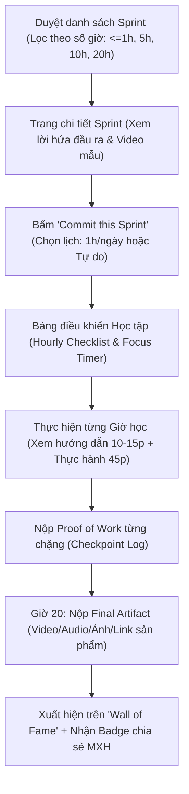
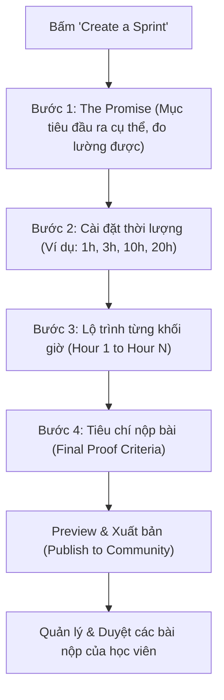

# PHẦN 2: TÀI LIỆU YÊU CẦU SẢN PHẨM (PRODUCT REQUIREMENTS DOCUMENT - PRD)

## 1. Tổng quan & Tầm nhìn Sản phẩm (Vision & Mission)
- **Tên dự án:** `Commit 20` (hoặc `Commit20.club`)
- **Slogan:** *"Chinh phục kỹ năng trong 20 giờ. Kết quả thấy ngay, chứng minh được."*
- **Sứ mệnh:** Xóa bỏ sự trì hoãn và tỉ lệ bỏ cuộc trong học tập bằng cách biến mọi kỹ năng thành các chặng nước rút (sprints) $\le 20$ giờ với sản phẩm đầu ra rõ ràng và cộng đồng chứng kiến.

---

## 2. Chân dung Người dùng (User Personas)

### Persona 1: "The Frustrated Starter" - Hoàng (24 tuổi, Dân văn phòng)
- **Pain point:** Từng mua 3 khóa học Udemy giảm giá nhưng chưa bao giờ học quá 20%. Rất muốn học đàn guitar hoặc nói tiếng Trung nhưng nghĩ phải mất 2-3 năm mới chơi được nên bỏ cuộc từ trước khi bắt đầu.
- **Mong muốn:** Một cam kết ngắn hạn, rõ ràng: "Chỉ cần bỏ 1 tiếng/ngày trong 20 ngày là tự đệm được 1 bài để hát sinh nhật bạn gái".
- **Hành vi trên app:** Chọn sprint $\le 20\text{h}$, bật đồng hồ bấm giờ 45-60 phút mỗi tối, nộp clip ngắn ghi lại tiến độ, hoàn thành nhận huy hiệu và khoe bạn bè.

### Persona 2: "The Micro-Expert / Creator" - Linh (27 tuổi, Content Creator / Giáo viên tự do)
- **Pain point:** Thấy làm một khóa học tổng thể đồ sộ (50-100 video) quá mệt và tốn công sản xuất. Muốn chia sẻ 1 bí quyết ngách rất đỉnh mà mình làm tốt (ví dụ: cách thiết lập Notion quản lý chi tiêu trong 2h, hoặc cách phát âm chuẩn 1 bài hát tiếng Hàn).
- **Mong muốn:** Nền tảng có cấu trúc sẵn để đóng gói kiến thức thành một thử thách 5-20 giờ, dễ dàng tương tác với học viên và nhận feedback/tiền thù lao.
- **Hành vi trên app:** Sử dụng Course Builder của Commit20 để định nghĩa: Lời hứa đầu ra + Dụng cụ cần chuẩn bị + Lộ trình từng giờ + Tiêu chuẩn chấm bài.

### Persona 3: "The Community Cheerleader" - Tuấn (22 tuổi, Sinh viên)
- **Hành vi:** Lướt xem các video trước/sau (Before & After) của những người đã hoàn thành 20 giờ thử thách (nghe ai đó hát từ dở tệ thành hát chuẩn bài tiếng Trung). Thả tim, bình luận, và được truyền cảm hứng để tự chọn 1 sprint cho mình.

---

## 3. Kiến trúc Thông tin & Luồng người dùng (User Flows)

### 3.1. Luồng Người học (Learner Journey)

### 3.2. Luồng Người tạo nội dung (Creator Journey)

---

## 4. Phân loại Tính năng theo mô hình MoSCoW (Feature Prioritization)

### 4.1. Phải có (MUST HAVE - Giai đoạn MVP)
1. **Khám phá khóa học (Sprint Catalog):**
   - Bộ lọc theo thời lượng: $\le 1\text{h}$, $\le 5\text{h}$, $\le 10\text{h}$, $20\text{h}$.
   - Bộ lọc theo chủ đề: Âm nhạc, Ngôn ngữ, Nấu ăn, Thể thao/Sức khỏe, Công nghệ/Productivity, Nghệ thuật.
   - Thẻ hiển thị: Ảnh bìa, Tên sprint, Lời hứa đầu ra (The Promise), Số người đang commit, Tỉ lệ hoàn thành.
2. **Trang chi tiết Sprint (Sprint Detail Page):**
   - Video/Ảnh demo sản phẩm hoàn thành của tác giả.
   - Checklist dụng cụ/kiến thức cần chuẩn bị trước Giờ 0.
   - Lộ trình chi tiết từng giờ (Hour-by-Hour breakdown).
3. **Phòng thực hành có bộ đếm thời gian (Practice Room & Focus Timer):**
   - Đồng hồ đếm giờ Pomodoro / Stopwatch ghi nhận thời gian thực hành thực tế.
   - Nội dung hướng dẫn của giờ đó (Video YouTube/Loom embed + Tài liệu Markdown).
   - Ô check-in ghi chú bài học & cảm nhận sau mỗi giờ.
4. **Hệ thống Nộp sản phẩm (Proof of Work Submission):**
   - Cho phép học viên tải lên hoặc nhúng link Video (YouTube/TikTok/Drive), Audio (SoundCloud/Vocaroo), Ảnh, GitHub/Figma link.
   - Bức tường vinh danh (Showcase Wall): Nơi hiển thị tất cả các bài tốt nghiệp của khóa học.
5. **Hồ sơ cá nhân & Thống kê (User Profile & Streaks):**
   - Tổng số giờ đã commit (Total hours practiced).
   - Chuỗi ngày liên tục (Current Streak).
   - Bộ sưu tập sản phẩm đã tạo ra (Personal Proof of Work Portfolio).
6. **Creator Studio cơ bản:**
   - Form tạo sprint theo chuẩn 4 bước của Commit20.

### 4.2. Nên có (SHOULD HAVE - Giai đoạn 2)
1. **Cam kết tài chính (Stake-to-Learn / Accountability Deposit):**
   - Người học có thể tùy chọn đặt cọc một khoản nhỏ (ví dụ 100.000đ).
   - Hoàn thành trong thời hạn cam kết $\to$ hoàn lại 100%. Nếu bỏ cuộc $\to$ trích chuyển vào quỹ cộng đồng / trả cho creator.
2. **Cộng đồng tương tác (Social Cheers & Feedback):**
   - Thả "Kudos / Clap" cho bài nộp của nhau.
   - Bình luận đóng góp ý kiến mang tính xây dựng.
3. **Tự động hóa thông báo (Reminders):**
   - Nhắc nhở qua Email hoặc Telegram Bot khi sắp đứt streak.

### 4.3. Có thể có (COULD HAVE - Giai đoạn 3)
1. **Ghép đôi bạn học (Study Buddy Matching):**
   - Tự động ghép 2 người cùng bắt đầu một sprint 20h vào cùng 1 ngày để thúc đẩy nhau.
2. **AI Curriculum Assistant:**
   - Cho phép creator nhập: "Tôi muốn dạy làm bánh mì Việt Nam trong 5 giờ", AI gợi ý khung phân rã 5 giờ chuẩn sư phạm.

---

## 5. Quy chuẩn Kiểm duyệt Chất lượng UGC (Curation Guidelines)

Để đảm bảo không bị biến thành "bãi rác nội dung", Commit 20 áp dụng nguyên tắc kiểm duyệt:
1. **Quy tắc "Không hứa viển vông":** Từ chối các tiêu đề như *"20h giỏi tiếng Anh như người bản xứ"* (bất khả thi). Chỉ duyệt các mục tiêu như *"20h tự tin phỏng vấn giới thiệu bản thân bằng tiếng Anh"* hoặc *"20h thuộc và phát âm chuẩn 100 câu giao tiếp sân bay"*.
2. **Quy tắc "Rõ ràng đầu ra":** Bắt buộc phải có định nghĩa rõ ràng về sản phẩm nộp cuối cùng (Final Artifact).
3. **Quy tắc "Tối đa 20 giờ":** Tổng thời gian dự kiến của lộ trình không được vượt quá 20 giờ.
