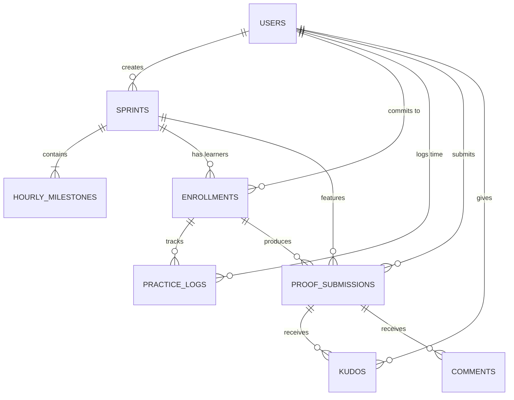

# PHẦN 4: KIẾN TRÚC KỸ THUẬT & CƠ SỞ DỮ LIỆU (DATABASE SCHEMA & TECH ARCHITECTURE)

## 1. Lựa chọn Tech Stack tối ưu cho MVP

Để xây dựng nhanh, hiệu năng cao, chi phí vận hành $0 ở giai đoạn đầu (free tier), kiến trúc đề xuất gồm:

- **Frontend / Fullstack Framework:** Next.js 15 (App Router, Server Components & Server Actions).
- **Styling & UI Kit:** Tailwind CSS + Shadcn UI + Lucide React (đẹp mắt, hiện đại, tối ưu mobile-first).
- **Database & Authentication:** Supabase (PostgreSQL, Row Level Security - RLS, Built-in Auth Google / Email OTP).
- **Media Storage (Proof of Work):** 
  - Hỗ trợ nhúng link trực tiếp (YouTube, TikTok, SoundCloud, Loom, GitHub) $\to$ Chi phí lưu trữ = $0.
  - Hỗ trợ tải trực tiếp ảnh/audio ngắn qua Cloudinary hoặc UploadThing.
- **Hosting & CI/CD:** Vercel (triển khai tự động qua GitHub repo).

---

## 2. Thiết kế Sơ đồ Cơ sở Dữ liệu (Entity Relationship Diagram)



---

## 3. Chi tiết Cấu trúc Bảng (PostgreSQL Schema DDL)

### 3.1. Bảng `profiles` (Hồ sơ người dùng)
Kế thừa từ `auth.users` của Supabase:
```sql
CREATE TABLE public.profiles (
    id UUID PRIMARY KEY REFERENCES auth.users(id) ON DELETE CASCADE,
    username TEXT UNIQUE NOT NULL,
    full_name TEXT NOT NULL,
    avatar_url TEXT,
    bio TEXT,
    total_practice_minutes INTEGER DEFAULT 0,
    current_streak_days INTEGER DEFAULT 0,
    last_practice_date DATE,
    role TEXT DEFAULT 'learner' CHECK (role IN ('learner', 'creator', 'admin')),
    created_at TIMESTAMPTZ DEFAULT NOW(),
    updated_at TIMESTAMPTZ DEFAULT NOW()
);
```

### 3.2. Bảng `sprints` (Các khóa học / Thử thách $\le 20\text{h}$)
```sql
CREATE TABLE public.sprints (
    id UUID PRIMARY KEY DEFAULT gen_random_uuid(),
    creator_id UUID NOT NULL REFERENCES public.profiles(id) ON DELETE CASCADE,
    title TEXT NOT NULL,
    slug TEXT UNIQUE NOT NULL,
    category TEXT NOT NULL CHECK (category IN ('music', 'language', 'cooking', 'fitness_health', 'productivity_tech', 'art_craft', 'other')),
    target_hours INTEGER NOT NULL CHECK (target_hours >= 1 AND target_hours <= 20),
    promise_deliverable TEXT NOT NULL, -- Lời hứa đầu ra cụ thể
    prerequisites TEXT, -- Đồ nghề cần chuẩn bị
    cover_image_url TEXT,
    demo_video_url TEXT, -- Video mẫu sản phẩm đầu ra do creator làm
    is_published BOOLEAN DEFAULT false,
    enrollment_count INTEGER DEFAULT 0,
    completion_count INTEGER DEFAULT 0,
    created_at TIMESTAMPTZ DEFAULT NOW(),
    updated_at TIMESTAMPTZ DEFAULT NOW()
);
```

### 3.3. Bảng `hourly_milestones` (Lộ trình từng khối giờ)
```sql
CREATE TABLE public.hourly_milestones (
    id UUID PRIMARY KEY DEFAULT gen_random_uuid(),
    sprint_id UUID NOT NULL REFERENCES public.sprints(id) ON DELETE CASCADE,
    hour_index INTEGER NOT NULL CHECK (hour_index >= 1 AND hour_index <= 20),
    title TEXT NOT NULL,
    guide_markdown TEXT NOT NULL, -- Hướng dẫn chi tiết
    embed_video_url TEXT, -- Video hướng dẫn 5-15 phút nếu có
    checklist JSONB DEFAULT '[]'::jsonb, -- Các đầu việc thực hành
    checkpoint_prompt TEXT, -- Gợi ý ghi chú hoặc bài tập nhỏ nộp sau giờ này
    created_at TIMESTAMPTZ DEFAULT NOW(),
    UNIQUE(sprint_id, hour_index)
);
```

### 3.4. Bảng `enrollments` (Cam kết của học viên)
```sql
CREATE TABLE public.enrollments (
    id UUID PRIMARY KEY DEFAULT gen_random_uuid(),
    user_id UUID NOT NULL REFERENCES public.profiles(id) ON DELETE CASCADE,
    sprint_id UUID NOT NULL REFERENCES public.sprints(id) ON DELETE CASCADE,
    status TEXT DEFAULT 'in_progress' CHECK (status IN ('in_progress', 'completed', 'abandoned')),
    pace_type TEXT DEFAULT 'daily_1h' CHECK (pace_type IN ('daily_1h', 'weekend_sprint', 'self_paced')),
    current_hour INTEGER DEFAULT 1,
    total_minutes_practiced INTEGER DEFAULT 0,
    staked_amount DECIMAL(10, 2) DEFAULT 0, -- Số tiền cọc cam kết (nếu bật tính năng)
    started_at TIMESTAMPTZ DEFAULT NOW(),
    completed_at TIMESTAMPTZ,
    UNIQUE(user_id, sprint_id)
);
```

### 3.5. Bảng `practice_logs` (Nhật ký bấm giờ thực hành)
```sql
CREATE TABLE public.practice_logs (
    id UUID PRIMARY KEY DEFAULT gen_random_uuid(),
    enrollment_id UUID NOT NULL REFERENCES public.enrollments(id) ON DELETE CASCADE,
    user_id UUID NOT NULL REFERENCES public.profiles(id) ON DELETE CASCADE,
    hour_index INTEGER NOT NULL,
    duration_minutes INTEGER NOT NULL CHECK (duration_minutes > 0),
    notes TEXT, -- Cảm nghĩ/khó khăn gặp phải
    created_at TIMESTAMPTZ DEFAULT NOW()
);
```

### 3.6. Bảng `proof_submissions` (Bằng chứng hoàn thành / Wall of Fame)
```sql
CREATE TABLE public.proof_submissions (
    id UUID PRIMARY KEY DEFAULT gen_random_uuid(),
    enrollment_id UUID NOT NULL REFERENCES public.enrollments(id) ON DELETE CASCADE,
    user_id UUID NOT NULL REFERENCES public.profiles(id) ON DELETE CASCADE,
    sprint_id UUID NOT NULL REFERENCES public.sprints(id) ON DELETE CASCADE,
    is_final_deliverable BOOLEAN DEFAULT true, -- true = tốt nghiệp, false = checkpoint từng chặng
    hour_index INTEGER, -- null nếu là final
    media_type TEXT NOT NULL CHECK (media_type IN ('video_embed', 'audio_embed', 'image_upload', 'external_link')),
    media_url TEXT NOT NULL,
    reflection TEXT, -- Lời chia sẻ của học viên sau khi hoàn thành
    upvotes_count INTEGER DEFAULT 0,
    is_featured BOOLEAN DEFAULT false,
    created_at TIMESTAMPTZ DEFAULT NOW()
);
```

### 3.7. Bảng `kudos` & `comments` (Tương tác xã hội)
```sql
CREATE TABLE public.kudos (
    id UUID PRIMARY KEY DEFAULT gen_random_uuid(),
    submission_id UUID NOT NULL REFERENCES public.proof_submissions(id) ON DELETE CASCADE,
    user_id UUID NOT NULL REFERENCES public.profiles(id) ON DELETE CASCADE,
    reaction_type TEXT DEFAULT 'clap' CHECK (reaction_type IN ('clap', 'fire', 'heart', 'mindblown')),
    created_at TIMESTAMPTZ DEFAULT NOW(),
    UNIQUE(submission_id, user_id)
);

CREATE TABLE public.comments (
    id UUID PRIMARY KEY DEFAULT gen_random_uuid(),
    submission_id UUID NOT NULL REFERENCES public.proof_submissions(id) ON DELETE CASCADE,
    user_id UUID NOT NULL REFERENCES public.profiles(id) ON DELETE CASCADE,
    content TEXT NOT NULL,
    created_at TIMESTAMPTZ DEFAULT NOW()
);
```

---

## 4. Bảo mật dữ liệu với Row Level Security (RLS)

- Mọi người dùng đều có thể đọc (`SELECT`) các sprint được `is_published = true` và các bài nộp `proof_submissions`.
- Chỉ người dùng sở hữu mới có quyền chỉnh sửa thông tin cá nhân (`profiles`), nhật ký bấm giờ (`practice_logs`), và bài nộp của mình (`proof_submissions`).
- Chỉ creator của sprint mới có quyền sửa đổi nội dung khóa học và các giờ học (`hourly_milestones`).
