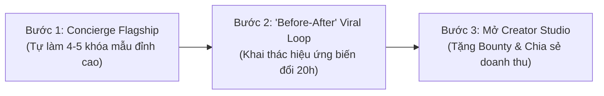
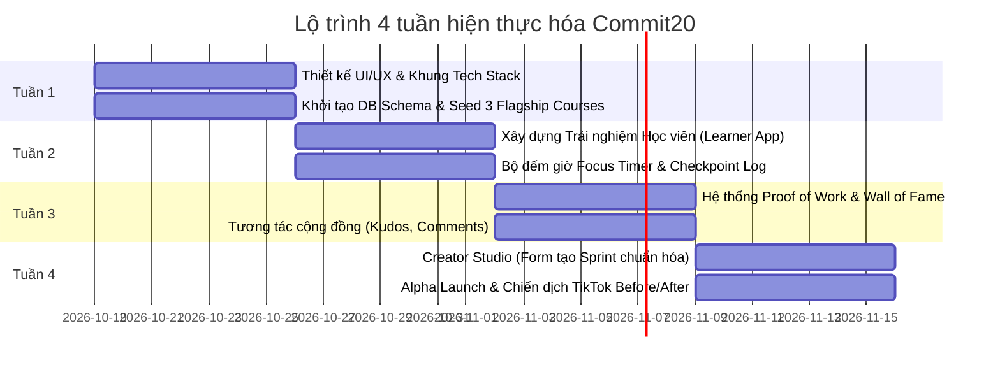

# PHẦN 5: CHIẾN LƯỢC GO-TO-MARKET & LỘ TRÌNH THỰC HIỆN (GTM & EXECUTION ROADMAP)

## 1. Giải bài toán "Con gà - Quả trứng" (The Cold-Start Problem)

Một nền tảng UGC kết hợp giữa Người học và Người dạy thường gặp bế tắc ban đầu: *Học viên vào không thấy khóa học sẽ rời đi, Creator vào không thấy học viên sẽ không đăng bài.*

### Chiến lược 3 bước giải quyết:

1. **Bước 1: Tự làm 4 - 5 khóa học Flagship (Concierge Phase):**
   - Đội ngũ sáng lập tự sản xuất hoặc hợp tác 1-1 với 3-5 người quen có kỹ năng tốt để đóng gói 4 khóa mẫu:
     1. *20h Hát bài tiếng Trung kinh điển.*
     2. *20h Đệm hát Guitar 4 hợp âm.*
     3. *1h Cài đặt nhịp ngủ 8 tiếng sâu.*
     4. *20h Nấu 5 mâm cơm gia đình.*
2. **Bước 2: Khai thác Viral Loop "Before vs After":**
   - Video biến đổi từ số 0 đến ngày thứ 20 (Day 0 vs Day 20) là một trong những loại nội dung có tỉ lệ viral tự nhiên cao nhất trên TikTok, Instagram Reels và YouTube Shorts.
   - *Kịch bản video viral:*
     - Giây 0-3: "Tôi không biết một chữ tiếng Trung nào..." (Kèm âm thanh hát dở tệ, lạc nhịp).
     - Giây 4-15: "Và tôi quyết định thử thách bản thân 20 giờ luyện tập theo phương pháp The First 20 Hours trên Commit20..." (Lướt nhanh hình ảnh bấm giờ từng ngày).
     - Giây 16-45: "Và đây là kết quả sau đúng 20 giờ!" (Hát cực hay và tự tin, phát âm chuẩn).
     - Kêu gọi hành động (CTA): "Thử thách 20 giờ của bạn là gì? Bắt đầu tại Commit20.club".
3. **Bước 3: Chương trình "Creator Bounty 20h":**
   - Thưởng nóng hoặc chia sẻ doanh thu cho 20 creator đầu tiên đóng gói được 1 sprint chất lượng có ít nhất 10 học viên hoàn thành.

---

## 2. Mô hình Kinh doanh (Monetization Models)

Commit 20 có thể kiếm tiền từ 4 dòng doanh thu linh hoạt:

1. **Stake-to-Learn (Cọc cam kết học tập - Win-Win):**
   - Học viên cọc 100.000đ – 200.000đ khi bấm tham gia sprint.
   - Nếu hoàn thành và nộp Proof of Work trong thời hạn cam kết: **Hoàn lại 100% tiền cọc**.
   - Nếu bỏ cuộc giữa chừng: Tiền cọc được chia: 50% chuyển cho Creator khóa học, 50% giữ lại cho nền tảng (phí dịch vụ).
   - 👉 Mô hình này thúc đẩy tỉ lệ hoàn thành cực cao, và người học chỉ mất tiền khi họ tự phá vỡ cam kết của chính mình.
2. **Paid Micro-Sprints (Khóa học trả phí):**
   - Creator có thể đặt giá cho Sprint của mình (ví dụ: 49.000đ – 199.000đ).
   - Commit 20 thu phí nền tảng 15% – 20%.
3. **Tip Jar / Buy Creator a Coffee:**
   - Sau khi học viên hoàn thành và nhận được kết quả vượt mong đợi, học viên có thể gửi tiền ủng hộ (Tip) trực tiếp cho tác giả.
4. **B2B Team Sprints:**
   - Bán các gói thử thách 20h cho doanh nghiệp (ví dụ: "Thử thách 20h học Prompt AI cho nhân viên văn phòng", "Thử thách 20h rèn thói quen đọc sách").

---

## 3. Kế hoạch Hành động 4 Tuần (Execution Roadmap)

### Tuần 1: Nền tảng & Dữ liệu hạt giống
- Khởi tạo dự án Next.js 15, Tailwind CSS, Lucide Icons, Shadcn UI trong repo `commit20`.
- Thiết lập Supabase Database theo schema đã thiết kế (`profiles`, `sprints`, `hourly_milestones`, `enrollments`).
- Nhập liệu (Seed data) đầy đủ cho 3 khóa học mẫu đầu tiên.

### Tuần 2: Trải nghiệm Học viên (The Core Learning Loop)
- Xây dựng giao diện Khám phá (Sprint Catalog) với bộ lọc theo số giờ ($\le 1\text{h}$, $\le 5\text{h}$, $\le 10\text{h}$, $20\text{h}$).
- Xây dựng trang chi tiết Sprint (Lộ trình, Lời hứa đầu ra, Checklist chuẩn bị).
- Xây dựng phòng thực hành (Focus Timer Room) với đồng hồ đếm giờ Pomodoro và ghi chú thực hành từng giờ.

### Tuần 3: Bằng chứng hoàn thành & Tương tác (The Proof Loop)
- Xây dựng luồng nộp bài (Nộp link video/audio YouTube, TikTok, SoundCloud hoặc ảnh).
- Xây dựng Bức tường Vinh danh (Showcase Wall / Wall of Fame) nơi hiển thị các video/bài nộp tốt nghiệp.
- Tính năng thả cảm xúc (Clap, Fire, Heart) và bình luận cổ vũ.

### Tuần 4: Creator Studio & Ra mắt thử nghiệm (Alpha Launch)
- Xây dựng Form tạo Sprint dành cho Creator (hướng dẫn nhập đúng 4 bước chuẩn).
- Mời 30-50 người dùng thử nghiệm hoàn thành 1 sprint đầu tiên để lấy Proof of Work thật.
- Sản xuất 2-3 clip ngắn "Day 0 vs Day 20" đăng TikTok/Reels để thu hút đợt người dùng đầu tiên.
